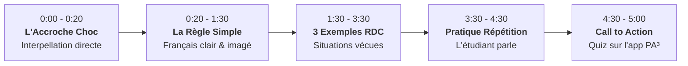

# Guide Pédagogique & Suggestions de Leçons Vidéo
## PA³ English Academy — "Parler Anglais Avec Assurance" (RDC)

> **Document Stratégique et Guide Pratique pour le Coach & l'Équipe Pédagogique**  
> *Plateforme d'apprentissage de l'anglais adaptée au contexte de la République Démocratique du Congo.*  
> **Auteur :** Coach David Liandja & Direction Académique PA³  
> **Accès sécurisé :** Document de travail réservé à l'administration  
> **Portail Administrateur :** [https://pa-english-academy.vercel.app/admin](https://pa-english-academy.vercel.app/admin)  
> **Page d'administration dédiée :** [https://pa-english-academy.vercel.app/admin/suggestions](https://pa-english-academy.vercel.app/admin/suggestions)

---

## 🌟 1. La Vision Pédagogique PA³ : Pourquoi Nos Étudiants Réussissent

En RDC, la majorité des cours d'anglais traditionnels échouent pour 3 raisons fondamentales :
1. **L'approche trop théorique et intimidante :** Les étudiants mémorisent des listes de verbes irréguliers sans jamais oser parler.
2. **L'inadéquation avec la réalité locale :** Les manuels importés parlent de métro à Londres ou de stations de ski au lieu de situations vécues à Kinshasa, Goma ou Lubumbashi.
3. **Le syndrome de la traduction mot-à-mot (Français/Lingala ➔ Anglais) :** Qui bloque la spontanéité et crée de l'anxiété.

### Les 4 Piliers de la Méthode PA³ :
- **Micro-apprentissage (5 à 8 minutes par jour) :** Des leçons concises et stimulantes, faisables dans le taxi-bus ou à la pause déjeuner.
- **Ancrage culturel congolais :** Exemples tirés du marché de Gambela, des entretiens chez Rawbank/Vodacom, des échanges au stade ou au bureau.
- **Immersion phonétique active :** Répétition à voix haute guidée, accent sur les sons pièges (*TH*, *-ED*, voyelles courtes).
- **Gamification valorisante :** Points XP, séries quotidiennes, badges et diplôme certifié CECRL vérifiable en ligne.

---

## 📚 2. Cursus Actuel & Leçons Interactives Déployées

La plateforme dispose déjà de leçons interactives calibrées avec système de reconnaissance vocale, quiz audio et exercices de mise en ordre :

### Niveau A1 : Débutant & Premiers Pas
1. **Les salutations (`/lecon/a1-salutations`) :**  
   - *Objectif :* Saluer selon l'heure de la journée (*Good morning, Good afternoon, Good evening, Good night*), demander *"How are you?"* et répondre poliment.
2. **Se présenter (`/lecon/a1-se-presenter`) :**  
   - *Objectif :* Nom, ville d'origine, âge avec le verbe *to be* (*"I am 22 years old"*, et non *"I have"*).
3. **Les nombres de 0 à 20 (`/lecon/a1-nombres-0-20`) :**  
   - *Objectif :* Compter, échanger son numéro de téléphone WhatsApp sans hésitation, différencier les terminaisons en *-teen* (13-19).
4. **L'Alphabet & Épeler son nom (`/lecon/a1-alphabet`) :**  
   - *Objectif :* Épeler son nom et prénom pour un visa ou un formulaire bancaire, donner son adresse email (*at = @*, *dot = .*).
5. **Pays, Villes & Nationalités (`/lecon/a1-pays-villes`) :**  
   - *Objectif :* Formuler d'où l'on vient (*"I'm from the Democratic Republic of Congo, I live in Kinshasa"*), nationalités (*Congolese*).
6. **La famille & Les Possessifs (`/lecon/a1-la-famille`) :**  
   - *Objectif :* Présenter ses proches, maîtriser la règle d'or des possessifs : *his* (son/sa à lui) et *her* (son/sa à elle).
7. **Combien ça coûte ? Achats & Négociation (`/lecon/a1-combien`) :**  
   - *Objectif :* Demander un prix (*"How much is this?"*), négocier une réduction (*"Can you give me a discount?"*), payer par M-Pesa.

---

## 🎬 3. Les 12 Leçons Vidéo Prioritaires à Enregistrer (Catalogue Clé en Main)

Voici les 12 modules vidéo les plus demandés par les apprenants congolais, prêts à être enregistrés par le Coach David Liandja :

### 💼 PÔLE A : ANGLAIS DU RECRUTEMENT & DES AFFAIRES (Top Valeur Ajoutée)

#### Vidéo 1 : « Réussir la question "Tell me about yourself" lors d'un entretien »
- **Niveau :** A2 - B1 • **Durée idéale :** 7 minutes
- **Le problème de l'étudiant :** Raconter sa vie depuis l'école primaire ou réciter mot pour mot son CV.
- **La méthode enseignée :** La règle des 3 P (*Present, Past, Future*) :
  1. *Present :* Qui je suis et mon rôle actuel.
  2. *Past :* 2 réussites concrètes et compétences acquises.
  3. *Future :* Pourquoi ce poste précis dans cette entreprise à Kinshasa est la suite logique.
- **Phrase clé à faire répéter :** *"I specialize in project management, and over the past three years, I successfully led..."*

#### Vidéo 2 : « Les 10 questions pièges des ONGs et multinationales en RDC »
- **Niveau :** B1 - B2 • **Durée idéale :** 10 minutes
- **Contexte :** Recrutements MONUSCO, agences de l'ONU, banques commerciales, sociétés minières.
- **Sujets abordés :** *"What is your greatest weakness?"*, *"Why do you want to work with us?"*, *"Describe a conflict you resolved"*.
- **Astuce du Coach :** Utiliser la méthode **STAR** (*Situation, Task, Action, Result*) pour structurer chaque réponse en anglais.

#### Vidéo 3 : « Rédiger un email professionnel moderne (Exit les formules du 19e siècle) »
- **Niveau :** A2 - B1 • **Durée idéale :** 6 minutes
- **Le problème :** Traduire littéralement *"Je viens par la présente solliciter..."*.
- **Formules modernes :**  
  - Accroche : *"I hope this email finds you well."*  
  - Pièce jointe : *"Please find attached my resume for your review."*  
  - Clôture : *"Looking forward to hearing from you soon. Best regards."*

#### Vidéo 4 : « Téléphoner et prendre un message en anglais sans stress »
- **Niveau :** A2 • **Durée idéale :** 5 minutes
- **Situations réelles :** Ligne qui coupe, bruit de fond à Kinshasa, interlocuteur qui parle trop vite.
- **Phrases de sauvetage :**  
  - *"Could you please speak a little slower?"*  
  - *"The line is breaking up. Could you repeat that, please?"*  
  - *"May I take a message, or would you like to call back later?"*

---

### 🗣️ PÔLE B : PRONONCIATION & CORRECTION D'ACCENT CONGOLAIS

#### Vidéo 5 : « La règle d'or pour prononcer le son -ED au passé »
- **Niveau :** A1 - A2 • **Durée idéale :** 6 minutes
- **Le piège :** Prononcer tous les verbes avec deux syllabes (*work-ed*, *ask-ed*, *look-ed*).
- **La règle simplifiée des 3 sons :**
  1. Son **/ɪd/** : uniquement après les sons **T** et **D** (*wanted, decided*).
  2. Son **/t/** : après les consonnes sourdes (*worked, stopped, laughed*).
  3. Son **/d/** : dans tous les autres cas (*played, called, lived*).
- **Exercice pratique :** Mettre la main sur la gorge pour sentir si les cordes vocales vibrent.

#### Vidéo 6 : « Arrêtez de dire "E-student" et "E-school" ! »
- **Niveau :** Débutant A1 • **Durée idéale :** 4 minutes
- **Le problème :** L'habitude francophone d'ajouter un son [e] ou [i] devant les mots qui commencent par la lettre S suivie d'une consonne (*Spain, speak, special, start*).
- **Exercice physique du Coach :** Faire le bruit du serpent (*Sssss*) avant de prononcer la suite du mot (*Sssss-peak, Sssss-tudent*).

#### Vidéo 7 : « Différencier le TH doux et le TH dur (Think vs This) »
- **Niveau :** A1 - A2 • **Durée idéale :** 5 minutes
- **Position de la langue :** Montrer la langue placée entre les dents de devant.
- **Paires contrastées :** *Think / Sink*, *Three / Free*, *This / Dis*.

#### Vidéo 8 : « Les voyelles courtes vs voyelles longues (Ship vs Sheep) »
- **Niveau :** A2 • **Durée idéale :** 6 minutes
- **Attention aux quiproquos gênants :**  
  - *Sheet* (drap/feuille) vs *Shit* (grossièreté).  
  - *Beach* (plage) vs *Bitch* (insulte).  
  - *Leave* (partir) vs *Live* (vivre).

---

### ⚡ PÔLE C : EXPRESSION ORALE & SPONTANÉITÉ

#### Vidéo 9 : « 15 expressions de transition pour sonner comme un bilingue »
- **Niveau :** A2 - B1 • **Durée idéale :** 6 minutes
- **Expressions indispensables :**  
  - *To be honest* (Pour être honnête).  
  - *As far as I'm concerned* (En ce qui me concerne).  
  - *At the end of the day* (En fin de compte).  
  - *You know what I mean?* (Vous voyez ce que je veux dire ?).

#### Vidéo 10 : « Comment arrêter de traduire dans sa tête »
- **Niveau :** Tous niveaux • **Durée idéale :** 8 minutes
- **Les 3 exercices mentaux quotidiens :**
  1. Nommer mentalement les objets de sa chambre en anglais au réveil.
  2. Décrire son trajet matinal à Kinshasa en monologue intérieur (*"The traffic on Boulevard du 30 Juin is heavy today"*).
  3. Mettre son téléphone et ses réseaux sociaux en anglais.

#### Vidéo 11 : « Commander au restaurant ou à l'hôtel en voyage »
- **Niveau :** A1 - A2 • **Durée idéale :** 5 minutes
- **Politesse anglophone :**  
  - Remplacer *"I want"* (perçu comme impoli et agressif) par *"Could I please have..."* ou *"I would like..."*.  
  - Demander l'addition : *"Could we have the check/bill, please?"*.

#### Vidéo 12 : « Les faux-amis les plus trompeurs en anglais »
- **Niveau :** A2 - B1 • **Durée idéale :** 6 minutes
- **Les pièges classiques :**  
  - *Currently* = Actuellement (et non couramment).  
  - *Eventually* = Finalement / À terme (et non éventuellement).  
  - *To attend* = Participer / Assister à (et non attendre).  
  - *Opportunity* = Opportunité / Occasion (ne pas confondre avec opportunisme).

---

## 🎙️ 4. La Formule du Tournage en 5 Étapes (Méthode 5 Minutes Chrono)

Pour chaque vidéo, suivez toujours cette structure infaillible :

### Script Type Prêt à Dérouler :
1. **Accroche (20s) :**  
   *« Si vous dites encore "I am agree with you", arrêtez tout de suite ! C'est une faute qui saute aux yeux de n'importe quel recruteur anglophone. Aujourd'hui, je vous montre la formule exacte en 30 secondes. »*
2. **Explication simple (1 min) :**  
   *« En français, "d'accord" est un adjectif, donc on utilise "être". Mais en anglais, "to agree" est déjà un VERBE à part entière ! Donc on ne met JAMAIS le verbe être devant. »*
3. **Exemples concrets (2 min) :**  
   - *"I agree with the manager."* (Je suis d'accord avec le responsable).  
   - *"I completely agree."* (Je suis tout à fait d'accord).  
   - *"I disagree."* (Je ne suis pas d'accord).
4. **Pratique en direct avec l'élève (1 min) :**  
   *« Répétez après moi avec énergie : I agree ! ... À votre tour ! (pause de 2 secondes en souriant face caméra). Excellent ! »*
5. **Appel à l'action (30s) :**  
   *« Ouvrez maintenant l'application PA³ English Academy, allez dans l'exercice de l'unité correspondante et gagnez vos 20 points XP. Rendez-vous sur pa-english-academy.vercel.app ! »*

---

## 🛠️ 5. Guide Technique : Tourner des Vidéos Pro à Kinshasa

Vous n'avez pas besoin d'une caméra de cinéma hollywoodienne. 95% des meilleures vidéos éducatives sur TikTok et YouTube sont tournées avec un simple smartphone :

### 1. La Lumière (Gratuite et naturelle)
- **Placez-vous toujours FACE à une fenêtre.** La lumière du jour de Kinshasa donne un teint naturel et éclatant.
- **Interdiction absolue :** Avoir une fenêtre ou une lampe forte dans votre dos (effet contre-jour qui assombrit le visage).

### 2. Le Son (L'élément le plus important)
- Les gens pardonnent une image moyenne, mais **personne n'écoute une vidéo avec un mauvais son**.
- Achetez un petit **micro-cravate sans fil** (type K9 ou Boya, environ $10 à $15 à Kinshasa) qui se branche directement sur le port de votre téléphone. Il éliminera l'écho de la pièce et les bruits de circulation.

### 3. Le Cadrage
- **Format Vertical (9:16) :** Idéal pour TikTok, Instagram Reels, Shorts YouTube et statuts WhatsApp. Cadrez de la poitrine jusqu'au sommet du crâne.
- **Format Paysage (16:9) :** Recommandé pour les longues masterclasses VOD sur grand écran et ordinateur.
- Nettoyez toujours la lentille de votre smartphone avec un tissu doux avant de lancer l'enregistrement.

---

## 📲 6. Comment Publier Vos Vidéos sur la Plateforme PA³

Une fois votre vidéo enregistrée sur votre téléphone :
1. **Option A (Gratuite et illimitée) :** Téléversez votre vidéo sur votre chaîne **YouTube** en mode *"Non répertorié"* (Unlisted).
2. **Option B (Streaming direct) :** Téléversez le fichier MP4 sur votre compte Cloudinary.
3. **Publication dans PA³ :**  
   - Connectez-vous sur votre tableau de bord administrateur : [https://pa-english-academy.vercel.app/admin](https://pa-english-academy.vercel.app/admin).  
   - Allez dans l'onglet **« Vidéothèque VOD »**.  
   - Cliquez sur **« Ajouter une nouvelle vidéo »**.  
   - Renseignez le titre, la catégorie, le niveau et collez le lien de votre vidéo.  
   - Cliquez sur **« Enregistrer »** : la vidéo est immédiatement disponible pour tous vos étudiants !

---
*PA³ English Academy • Parler Anglais Avec Assurance • Kinshasa, RDC © 2026.*
