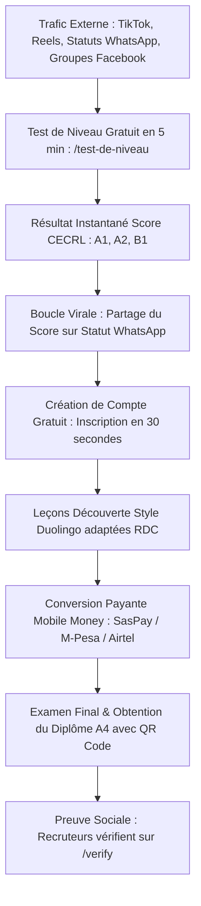

# Stratégie Marketing & Plan d'Acquisition Utilisateurs
## PA³ English Academy — "Parler Anglais Avec Assurance" (RDC)

> **Document Stratégique de Référence pour l'Acquisition, la Viralité et la Monétisation**  
> *Plateforme conçue pour la République Démocratique du Congo (Kinshasa, Lubumbashi, Goma, Matadi et Diaspora).*  
> **Auteur :** Coach David Liandja & Direction Stratégique PA³ English Academy  
> **Date de révision :** Octobre 2026  
> **URL officielle :** [https://pa-english-academy.vercel.app](https://pa-english-academy.vercel.app)  
> **Portail de vérification :** [https://pa-english-academy.vercel.app/verify](https://pa-english-academy.vercel.app/verify)

---

## 🎯 1. Analyse du Marché et Cibles Prioritaires (Personas)

En RDC, la maîtrise de l'anglais n'est pas un loisir, c'est un **accélérateur socio-économique d'ascension professionnelle** et un filtre éliminatoire pour l'emploi formel.

### Matrice des Segments Cibles

| Persona | Profil & Démographie | Problème Majeur (Pain Point) | Déclencheur d'Achat | Pouvoir d'Achat | Canaux Prioritaires |
| :--- | :--- | :--- | :--- | :--- | :--- |
| **1. Le Candidat ONG & Multinationales** | 24 - 38 ans • Diplômé universitaire • Kinshasa, Goma, Lubumbashi | CV rejeté lors des recrutements MONUSCO, Vodacom, Rawbank, USAID, OMS faute d'anglais opérationnel. | Décrocher un poste à 4 chiffres ($1 500+ / mois). Besoin d'un certificat officiel CECRL vérifiable. | Moyen à Élevé ($15 - $50) | LinkedIn, Facebook, Groupes WhatsApp Emploi RDC |
| **2. L'Étudiant Universitaire Ambitieux** | 18 - 25 ans • UNIKIN, UPC, UCC, UPN, ISC, ISIPA | Cursus francophone théorique, incapacité à s'exprimer avec fluidité en public. | Bourses d'études (Chevening, Fulbright), études à l'étranger ou préparation du premier stage. | Modeste ($2 - $10) | TikTok, Reels, Campus, Cercles d'anglais |
| **3. Le Cadre d'Entreprise & Commerçant** | 32 - 55 ans • Banquiers, importateurs, miniers Katanga | Difficultés lors des voyages et réunions à Dubaï, Guangzhou, Johannesburg ou Nairobi. | Négocier directement sans intermédiaire et sans complexe d'infériorité. | Élevé ($30 - $100+) | Recommandation bouche-à-oreille, Statuts WhatsApp |

---

## 🧲 2. L'Entonnoir d'Acquisition (Funnel & Lead Magnet)

Pour vaincre le scepticisme et acquérir des milliers d'utilisateurs sans budget publicitaire massif, la stratégie repose sur un **produit d'appel 100% gratuit, irrésistible et immédiat** :

### Le Levier Clé : Le Test de Niveau CECRL (`/test-de-niveau`)
- **Promesse :** *"Évaluez gratuitement votre vrai niveau d'anglais en 5 minutes selon le cadre européen CECRL."*
- **Zéro friction :** Accessible immédiatement sans carte bancaire, optimisé pour les connexions 3G faibles.
- **Boucle Virale WhatsApp :** À l'issue du test, l'apprenant reçoit un bouton un clic pour publier sur son statut :  
  > *« 🎓 J'ai testé mon niveau d'anglais sur PA³ English Academy et j'ai obtenu le niveau A2 ! Teste gratuitement le tien ici : https://pa-english-academy.vercel.app/test-de-niveau »*

---

## 📱 3. Stratégie Multi-Canaux Spécifique RDC

### 🟢 A. WhatsApp Marketing (Canal Roi à Kinshasa & Provinces)
En RDC, WhatsApp est le système d'exploitation social par excellence.
1. **Statuts WhatsApp Quotidiens du Coach David :**
   - Mini-sondages le matin : *"Comment dit-on 'Je vous reviens' en anglais professionnel ? A) I come back to you / B) I will get back to you"*.
   - Débriefing l'après-midi en note vocale avec le lien de la leçon.
2. **Canal / Groupe VIP "English Express PA³" :**
   - Une capsule audio de 60 secondes chaque matin : l'erreur courante des francophones de Kinshasa et sa correction.
   - Témoignages vidéo courts d'apprenants montrant leur diplôme imprimé avec le sceau d'or et le QR code.

### 🎬 B. TikTok & Instagram Reels (Portée Organique Maximale)
Coach David Liandja incarne l'autorité bienveillante et l'excellence congolaise :
- **Série "Ne dites plus jamais..." :** Corriger les traductions littérales courantes (*"I am agree" ➔ "I agree"*, *"I have hunger" ➔ "I am hungry"*).
- **Série "L'anglais du Job Interview à Kin" :** Les questions types posées lors des recrutements en RDC (*"Tell me about a challenge you solved"*, *"What are your salary expectations?"*).
- **Série "Lingala to English" :** Des équivalences punchy pour créer une connivence culturelle (*"Kaka boye" ➔ "Just like that"*).
- **Appel à l'action systématique :** *"Passez votre test officiel gratuit sur le lien en bio !"*

### 🔵 C. Facebook & Groupes d'Opportunités
- Ciblez les communautés les plus actives de demandeurs d'emploi et de bourses :
  - *Offres d'emploi Kinshasa*, *Opportunités en RDC*, *Bourses d'études pour Congolais*, *Alumni UNIKIN/UPC*.
- **Angle d'accroche :** Mettre l'accent sur le fait que **80% des CV sont éliminés dès l'entretien d'anglais**.
- Promouvoir la vérification publique des diplômes PA³ :  
  *« Valorisez votre CV avec une attestation certifiée avec QR code opposable aux employeurs : [https://pa-english-academy.vercel.app/verify](https://pa-english-academy.vercel.app/verify) »*

### 💼 D. LinkedIn (Recrutement & B2B)
- Publications orientées leadership et productivité économique bilingue :
  - *« Pourquoi les entreprises de la RDC peinent à trouver des cadres bilingues qualifiés. »*
  - Analyses de descriptions de postes publiées par Vodacom, Rawbank, BCDC, Glencore et MONUSCO montrant les critères d'anglais exigés.
- Invitation directe des responsables RH et recruteurs de Kinshasa à utiliser le portail `/verify` pour vérifier les candidats certifiés PA³.

---

## 🏫 4. Guerilla Marketing & Partenariats Terrain

### 1. Programme d'Ambassadeurs de Campus (UNIKIN, UPC, UCC, UPN)
- Recruter **10 à 20 leaders étudiants** (présidents de cercles d'anglais, délégués facultaires).
- Leur fournir un code de parrainage personnalisé donnant droit à **20% de commission Mobile Money** sur chaque souscription réalisée.
- Affichage dans les campus avec QR Code grand format :  
  *« Teste ton niveau d'anglais gratuitement sur ton téléphone ! »*

### 2. Le "PA³ National English Challenge" (Compétition Inter-Universités)
- Utiliser la page `/classement` de la plateforme.
- Organiser un tournoi mensuel du meilleur apprenant de Kinshasa avec remise de prix officielle par Coach David (Trophée physique, diplôme encadré, bourse de formation).

### 3. Partenariats avec les Hubs & Espaces de Coworking
- Silikin Village, Ingenious City, Orange Digital Center Kinshasa.
- Organiser des ateliers mensuels en présentiel : *"English for Startups & Pitching to International Investors"*, propulsés par PA³ English Academy.

---

## 💳 5. Stratégie de Prix & Monétisation Mobile Money

En RDC, l'accès au paiement est la clé de la conversion.

### Principes Directeurs
1. **Intégration Mobile Money totale :** M-Pesa, Airtel Money, Orange Money, Afrimoney via SasPay.
2. **Prix psychologique accessible en Francs Congolais (FC) et Dollars ($) :**
   - **Accès Niveau A1 :** Gratuit (Amorçage & découverte).
   - **Pass Examen & Diplôme Officiel A1/A2 :** 8 500 FC ou $3 USD (Seuil d'achat impulsif).
   - **Abonnement Illimité Mensuel :** $10 USD (Accès complet à tous les cours, VOD et certifications).
   - **Pack Pro Coaching avec Coach David :** $30 - $50 USD (Corrections personnalisées et sessions privées).
3. **Mise en valeur de la rentabilité pour l'apprenant :**
   - Comparaison : *"Un cours d'anglais traditionnel en centre à Gombe coûte entre $100 et $250 par mois. Avec PA³, apprenez sur votre téléphone pour le prix de 2 cartes de crédit Mobile Money."*

---

## 🏆 6. Le Sceau de Crédibilité : L'Argument du Diplôme Vérifiable

Le diplôme PA³ English Academy n'est pas une simple image, c'est un **document certifié** répondant aux normes internationales :
- **Format A4 Paysage strict :** Imprimable en 1 seule page sans débordement, prêt à être joint aux dossiers de visa ou de candidature.
- **QR Code scannable instantané :** Tout recruteur peut scanner le diplôme imprimé pour vérifier son authenticité en direct.
- **Portail Public `/verify` :** Consultable en ligne à l'adresse [https://pa-english-academy.vercel.app/verify](https://pa-english-academy.vercel.app/verify).
- **Ventilation CECRL :** Détail chiffré des 4 compétences (*Listening, Speaking, Reading, Grammar*).
- **Signature officielle du Coach David Liandja.**

---

## 🗓️ 7. Plan d'Exécution sur 30 Jours

| Semaine | Objectif Principal | Actions Opérationnelles | Indicateur Clé (KPI) |
| :--- | :--- | :--- | :--- |
| **Semaine 1** | **Amorçage & Notoriété** | • Tournage de 10 vidéos courtes TikTok/Reels avec Coach David. • Lancement de la campagne WhatsApp "Fais ton test de niveau gratuit en 5 min". • Publication sur les comptes personnels de l'équipe. | 1 000 tests de niveau complétés |
| **Semaine 2** | **Viralité & Groupes Emploi** | • Posts ciblés dans 15 groupes Facebook Emploi Kinshasa. • Présentation du diplôme officiel vérifiable par QR Code. • Activation des premiers cercles d'anglais à l'UPC et l'UNIKIN. | 2 500 utilisateurs inscrits |
| **Semaine 3** | **Réseau d'Ambassadeurs** | • Recrutement de 15 ambassadeurs étudiants avec affiliation Mobile Money. • Lancement du premier Challenge Classement RDC (`/classement`). • Diffusion d'un guide PDF gratuit : *"50 expressions indispensables pour réussir un entretien en anglais à Kinshasa"*. | 5 000 utilisateurs actifs |
| **Semaine 4** | **Monétisation & Conversion** | • Organisation d'une Masterclass WhatsApp / VOD gratuite animée par Coach David. • Offre promotionnelle limitée sur le déblocage des certifications officielles A2/B1 via Mobile Money. • Mise en avant des premiers apprenants certifiés avec témoignages vidéo. | 150 à 300 certifications payantes vendues |

---

## 📢 8. Scripts & Messages Prêts à l'Emploi

### Message Statut WhatsApp & Groupes :
> 🚀 **Votre niveau d'anglais bloque-t-il votre carrière à Kinshasa ?**  
> 80% des recruteurs en RDC éliminent les candidats incapables de soutenir une conversation professionnelle en anglais.  
>  
> 💡 **Découvrez gratuitement votre vrai niveau selon la norme internationale CECRL en 5 minutes :**  
> 👉 https://pa-english-academy.vercel.app/test-de-niveau  
>  
> 🇨🇩 Conçu pour la RDC par le Coach David Liandja. Faible consommation de données 3G.  
> Partagez ce test avec un ami qui cherche du travail !

### Message d'Accroche pour Candidats aux Bourses & Visas :
> 🎓 **Besoin d'attester de votre niveau d'anglais pour un visa, une bourse ou un employeur ?**  
> Obtenez votre certificat officiel d'anglais PA³ Academy vérifiable en ligne 24h/24 par QR Code :  
> 👉 https://pa-english-academy.vercel.app/verify  
> Validez vos compétences sans vous ruiner avec le paiement direct par M-Pesa, Airtel Money et Orange Money.

---

## 📊 9. Tableau de Bord des Métriques à Suivre (KPIs)

1. **Volume d'acquisition :** Nombre de tests de niveau complétés par jour (`/test-de-niveau`).
2. **Taux de complétion des leçons :** Nombre de leçons terminées par apprenant (`/lecon/...`).
3. **Taux de conversion payant :** Ratio `Visiteurs ➔ Utilisateurs inscrits ➔ Certificats payés via SasPay`.
4. **Vérifications de diplômes :** Nombre de scans de QR Code enregistrés sur `/verify/[code]`.
5. **Partages viraux :** Clics sur le bouton WhatsApp de partage de score.

---
*PA³ English Academy • Parler Anglais Avec Assurance • Kinshasa, RDC © 2026.*
